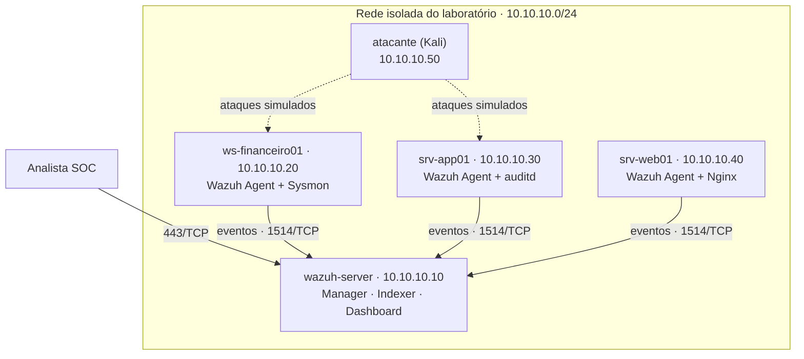

# Wazuh Enterprise Security Operations Lab

**Laboratório de Segurança da Informação | Blue Team | SOC | SIEM | Detection Engineering**

Projeto prático de construção de um ambiente corporativo simulado para implementação, administração e integração de ferramentas de segurança da informação, utilizando o **Wazuh como plataforma central de monitoramento e detecção de ameaças**.

O objetivo é reproduzir cenários próximos aos encontrados em ambientes empresariais, permitindo estudar e aplicar conceitos de monitoramento de endpoints, análise de logs, identificação de vulnerabilidades, detecção de ameaças, resposta a incidentes e hardening de sistemas.

> **Status:** Em desenvolvimento.

---

## 1. Objetivos do projeto

O laboratório foi desenvolvido com o propósito de consolidar conhecimentos práticos em segurança defensiva (Blue Team), explorando atividades comuns em um ambiente de Security Operations Center (SOC).

Entre os principais objetivos estão:

- Implementar e administrar uma infraestrutura centralizada de monitoramento com Wazuh.
- Integrar endpoints Windows e Linux ao ambiente de monitoramento.
- Centralizar e analisar eventos de segurança.
- Desenvolver regras personalizadas de detecção.
- Correlacionar eventos com a matriz MITRE ATT&CK.
- Monitorar alterações em arquivos e configurações críticas.
- Identificar vulnerabilidades e avaliar riscos.
- Simular atividades maliciosas em ambiente controlado.
- Investigar alertas e documentar incidentes de segurança.

**Frentes do projeto:**

| Frente | O que é demonstrado |
| --- | --- |
| Arquitetura de monitoramento | SIEM centralizado, agentes, grupos e configuração em escala |
| Detection Engineering | Regras próprias, decoders, severidade e mapeamento MITRE ATT&CK |
| Gestão de vulnerabilidades | CVEs, priorização além do CVSS, correção e validação |
| File Integrity Monitoring | Detecção de alterações não autorizadas com *who-data* |
| Security Configuration Assessment | Hardening CIS com pontuação antes e depois |
| Simulação de ataques | Atomic Red Team e matriz de cobertura de detecção |
| Resposta a incidentes | Active Response com runbook, exceções e reversão |
| Incidente completo | Investigação e relatório profissional de um ataque encadeado |

## 2. Arquitetura do laboratório

A infraestrutura utiliza máquinas virtuais distribuídas entre VirtualBox e VMware, simulando uma pequena rede corporativa.

A arquitetura foi planejada para manter uma rede interna isolada para comunicação entre os equipamentos, preservando o acesso à internet por meio de interfaces NAT.

### Cenário: NovaTech Ltda

A NovaTech é uma empresa fictícia com uma estação de trabalho do setor Financeiro, um servidor de aplicação e um servidor web. O SOC da NovaTech monitora esses ativos a partir de um servidor Wazuh central.

### Topologia

| Ativo | Função | Sistema | IP |
| --- | --- | --- | --- |
| `wazuh-server` | SIEM/XDR: Manager, Indexer e Dashboard; servidor NTP interno | Rocky Linux | 10.10.10.10 |
| `ws-financeiro01` | Estação de trabalho corporativa | Windows 11 | 10.10.10.20 |
| `srv-app01` | Servidor de aplicação | Rocky Linux | 10.10.10.30 |
| `srv-web01` | Servidor web (Nginx) | Rocky Linux | 10.10.10.40 |
| `atacante` | Simulação de ameaças (usado a partir da Fase 4) | Kali Linux | 10.10.10.50 |

Todas as VMs ficam em uma rede NAT isolada do VirtualBox (`10.10.10.0/24`), separada da rede doméstica, porque o laboratório contém ativos propositalmente vulneráveis.

*Observação: o endereçamento representa o planejamento da rede do laboratório e poderá ser atualizado conforme a implementação.*

### Diagrama lógico




**Decisões de arquitetura:**

- **Wazuh 4.14.x**, a linha estável. O Wazuh 5.0 está em beta e será avaliado como próximo passo.
- **Configuração centralizada por grupos** (`windows-workstations`, `linux-servers`, `web-servers`): nenhum agente é configurado manualmente.
- **Telemetria enriquecida** com Sysmon, PowerShell Script Block Logging, políticas de auditoria do Windows e auditd, em vez de depender só dos logs padrão.
- **Eventos brutos (archives) indexados**, para apoiar o desenvolvimento de detecções, com retenção de 30 dias.
- **Fonte de horário única** (NTP interno), essencial para reconstruir a linha do tempo de incidentes.

---

## 3. Tecnologias e ferramentas

| Tecnologia | Aplicação no projeto |
|---|---|
| Wazuh | SIEM, monitoramento e detecção de ameaças |
| Rocky Linux | Sistema operacional do servidor Wazuh |
| Windows 11 | Endpoint de monitoramento |
| Kali Linux | Testes de segurança controlados |
| Sysmon | Coleta detalhada de eventos do Windows |
| Auditd | Auditoria de eventos no Linux |
| MITRE ATT&CK | Classificação e contextualização de técnicas de ataque |
| VirtualBox | Virtualização de servidores Linux |
| VMware Workstation | Virtualização de endpoints Windows |
| NTP / Chrony | Sincronização de horário entre os sistemas |

## 4. Módulos do laboratório

O projeto está organizado em módulos que representam diferentes áreas de atuação de um profissional de segurança defensiva.

### 4.1. Infrastructure & Monitoring

Implementação da infraestrutura de monitoramento, incluindo:

- Instalação e configuração do Wazuh.
- Configuração dos agentes Windows e Linux.
- Integração de endpoints ao servidor central.
- Configuração de sincronização de horário (NTP).
- Centralização e visualização de eventos.

### 4.2. Detection Engineering

Desenvolvimento e aprimoramento de mecanismos de detecção:

- Criação de regras personalizadas no Wazuh.
- Análise de eventos do Windows e Linux.
- Identificação de comportamentos suspeitos.
- Classificação de eventos por severidade.
- Mapeamento de detecções para MITRE ATT&CK.

### 4.3. Vulnerability Management

Implementação de práticas de gerenciamento de vulnerabilidades:

- Identificação de softwares vulneráveis.
- Monitoramento de CVEs.
- Análise de criticidade utilizando CVSS.
- Avaliação de exposição dos endpoints.
- Documentação de riscos e recomendações.

### 4.4. File Integrity Monitoring (FIM)

Monitoramento de integridade de arquivos e diretórios:

- Identificação de modificações em arquivos críticos.
- Monitoramento de criação e exclusão de arquivos.
- Detecção de alterações não autorizadas.
- Análise dos eventos gerados pelo Wazuh.

### 4.5. Incident Response

Simulação e investigação de incidentes de segurança:

- Execução de atividades controladas para geração de eventos.
- Identificação e análise de alertas.
- Construção de timelines de incidentes.
- Investigação de evidências.
- Aplicação de medidas de contenção.
- Elaboração de relatórios técnicos.

### 4.6. Security Hardening & Configuration Assessment

Avaliação da postura de segurança dos sistemas:

- Análise de configurações inseguras.
- Aplicação de boas práticas de hardening.
- Avaliação de políticas de segurança.
- Monitoramento de configurações críticas.
- Utilização do Security Configuration Assessment (SCA).

### 4.7. Network Security & Fortinet Integration

Expansão da infraestrutura para incluir ferramentas de segurança de rede:

- Integração do FortiGate ao Wazuh.
- Coleta e análise de logs de firewall.
- Monitoramento de conexões e tráfego de rede.
- Identificação de atividades suspeitas.
- Correlação de eventos de rede com eventos dos endpoints.

## 5. Simulações de segurança

O laboratório também será utilizado para reproduzir comportamentos associados a técnicas de ataque, sempre em ambiente isolado e controlado.

As simulações permitirão avaliar a capacidade de detecção e investigação da infraestrutura.

Exemplos de cenários planejados:

- Tentativas de força bruta.
- Execução de processos suspeitos.
- Alterações em arquivos críticos.
- Criação de usuários não autorizados.
- Modificações em mecanismos de persistência.
- Atividades suspeitas relacionadas ao PowerShell.
- Reconhecimento e enumeração de rede.

Quando aplicável, serão utilizadas ferramentas como Atomic Red Team para reproduzir técnicas associadas à MITRE ATT&CK.

## 6. Documentação e evidências

Cada implementação relevante deverá possuir documentação técnica, incluindo:

- Objetivo do cenário.
- Arquitetura e configurações utilizadas.
- Procedimentos de implementação.
- Evidências de execução.
- Eventos e alertas identificados.
- Regras de detecção utilizadas.
- Classificação MITRE ATT&CK, quando aplicável.
- Análise dos resultados.
- Recomendações de segurança.

O objetivo é manter um histórico técnico que permita reproduzir os cenários e demonstrar os resultados obtidos.

## 7. Roadmap


| Fase | Entrega | Status |
| --- | --- | --- |
| 0. Preparação | Rede isolada, VMs, NTP, snapshots | ✅ Concluída |
| 1. Infraestrutura | Agentes, grupos, Sysmon, auditd, validação da coleta | 🔄 Em andamento |
| 2. Monitoramento | FIM, detecção de vulnerabilidades e SCA | ⏳ Planejada |
| 3. Detection Engineering | Biblioteca de detecções próprias | ⏳ Planejada |
| 4. Simulação de ataques | Atomic Red Team e matriz de cobertura | ⏳ Planejada |
| 5. Resposta a incidentes | Active Response e runbook | ⏳ Planejada |
| 6. Incidente completo | Relatório NVT-2026-001 | ⏳ Planejada |
| 7. Portfólio | Vídeo de demonstração e publicação | ⏳ Planejada |

O registro diário do que foi feito, dos problemas encontrados e de como foram resolvidos está em [`docs/diario.md`](docs/diario.md).

## 8. Telemetria coletada

| Fonte | Ativo | Eventos de interesse |
| --- | --- | --- |
| Windows Security | ws-financeiro01 | 4624/4625 (logon), 4720 (conta criada), 4732 (inclusão em grupo), 4688 (processo, com linha de comando), 4698 (tarefa agendada) |
| Sysmon ([sysmon-modular](https://github.com/olafhartong/sysmon-modular)) | ws-financeiro01 | 1 (processo), 3 (rede), 11 (arquivo), 13 (registro) |
| PowerShell Operational | ws-financeiro01 | 4104 (Script Block Logging) |
| Windows Defender | ws-financeiro01 | Detecções e alterações de configuração |
| auditd | srv-app01, srv-web01 | Alterações em `passwd`, `shadow`, `sudoers`, `sshd_config`; comandos executados como root |
| `/var/log/secure` | srv-app01, srv-web01 | Autenticação SSH e uso de `sudo` |
| Nginx | srv-web01 | Logs de acesso e de erro |

As configurações completas estão em [`configs/`](configs/).

---

## 9. Biblioteca de detecções

Cada detecção tem uma ficha em [`detections/`](detections/) com lógica, teste, evidência, falsos positivos conhecidos e resposta recomendada.

| ID | Detecção | Fonte | MITRE ATT&CK | Status |
| --- | --- | --- | --- | --- |
| DET-001 | Brute force SSH seguido de login bem-sucedido | sshd | [T1110.001](https://attack.mitre.org/techniques/T1110/001/) | ⏳ |
| DET-002 | Conta adicionada ao grupo Administradores | Windows Security | [T1098](https://attack.mitre.org/techniques/T1098/) | ⏳ |
| DET-003 | Persistência em chave Run do registro | Sysmon | [T1547.001](https://attack.mitre.org/techniques/T1547/001/) | ⏳ |
| DET-004 | Tentativa de desativar o Microsoft Defender | Sysmon / Defender | [T1562.001](https://attack.mitre.org/techniques/T1562/001/) | ⏳ |
| DET-005 | PowerShell ofuscado ou download em memória | PowerShell 4104 | [T1059.001](https://attack.mitre.org/techniques/T1059/001/) | ⏳ |
| DET-006 | Usuário adicionado ao grupo wheel | auditd | [T1098](https://attack.mitre.org/techniques/T1098/) | ⏳ |

**Ciclo de desenvolvimento de cada detecção:** simular o comportamento → analisar o evento bruto → verificar a cobertura nativa → escrever a regra → testar no `wazuh-logtest` → validar no dashboard → testar falsos positivos → documentar.

---

## 10. Estrutura do repositório

```
wazuh-enterprise-soc-lab/
├── README.md
├── docs/
│   ├── arquitetura.md
│   ├── diario.md              # registro de execução e troubleshooting
│   └── img/
├── configs/
│   ├── manager/               # ossec.conf (sanitizado) e agent.conf por grupo
│   ├── windows/               # sysmonconfig.xml e políticas de auditoria
│   └── linux/                 # regras do auditd
├── detections/
│   ├── rules/                 # regras personalizadas
│   ├── decoders/
│   └── DET-XXX.md             # uma ficha por detecção
├── active-response/           # scripts e RUNBOOK.md
├── simulations/               # testes executados e matriz de cobertura
└── reports/                   # relatórios de incidente, vulnerabilidades e SCA
```

---

## 11. Como reproduzir o laboratório

**Requisitos do host:** 16 GB de RAM (recomendado 24 GB ou mais para todas as VMs ligadas ao mesmo tempo), 200 GB livres em disco e VirtualBox 7.x.

| VM | vCPU | RAM | Disco |
| --- | --- | --- | --- |
| wazuh-server | 4 | 8 GB | 50 GB |
| ws-financeiro01 | 2 | 4 GB | 60 GB |
| srv-app01 | 1–2 | 2 GB | 20 GB |
| srv-web01 | 1 | 2 GB | 20 GB |
| atacante | 2 | 2–4 GB | 40 GB |

**Passos resumidos:**

1. Criar a NAT Network isolada:
   ```bash
   VBoxManage natnetwork add --netname LabNovaTech --network "10.10.10.0/24" --enable --dhcp off
   ```
2. Instalar o Wazuh no `wazuh-server` seguindo o [guia de instalação oficial](https://documentation.wazuh.com/current/installation-guide/index.html).
3. Configurar IPs fixos, hostnames e NTP em todas as VMs ([`docs/arquitetura.md`](docs/arquitetura.md)).
4. Criar os grupos de agentes e copiar os `agent.conf` de [`configs/manager/`](configs/manager/).
5. Preparar a telemetria (Sysmon, auditoria do Windows, auditd) com os arquivos de [`configs/`](configs/).
6. Instalar os agentes na mesma versão do manager.
7. Copiar as regras de [`detections/rules/`](detections/rules/) para `/var/ossec/etc/rules/` e reiniciar o manager.

---


## 12. Considerações finais

Este projeto representa um ambiente contínuo de aprendizado e experimentação em segurança da informação, com foco em operações de segurança, monitoramento de infraestrutura, engenharia de detecção e resposta a incidentes.

Mais do que instalar ferramentas, a proposta é compreender como os diferentes componentes de segurança trabalham em conjunto para identificar, investigar e responder a ameaças em um ambiente corporativo.

**Projeto desenvolvido para fins educacionais e de demonstração técnica. Todas as simulações são realizadas em infraestrutura controlada.**

## Autor

**[Seu nome]** — Analista de Segurança da Informação | Blue Team

[](https://www.linkedin.com/in/fabio-signorini/)

Sugestões e discussões técnicas são bem-vindas: abra uma *issue* ou me chame no LinkedIn.

---